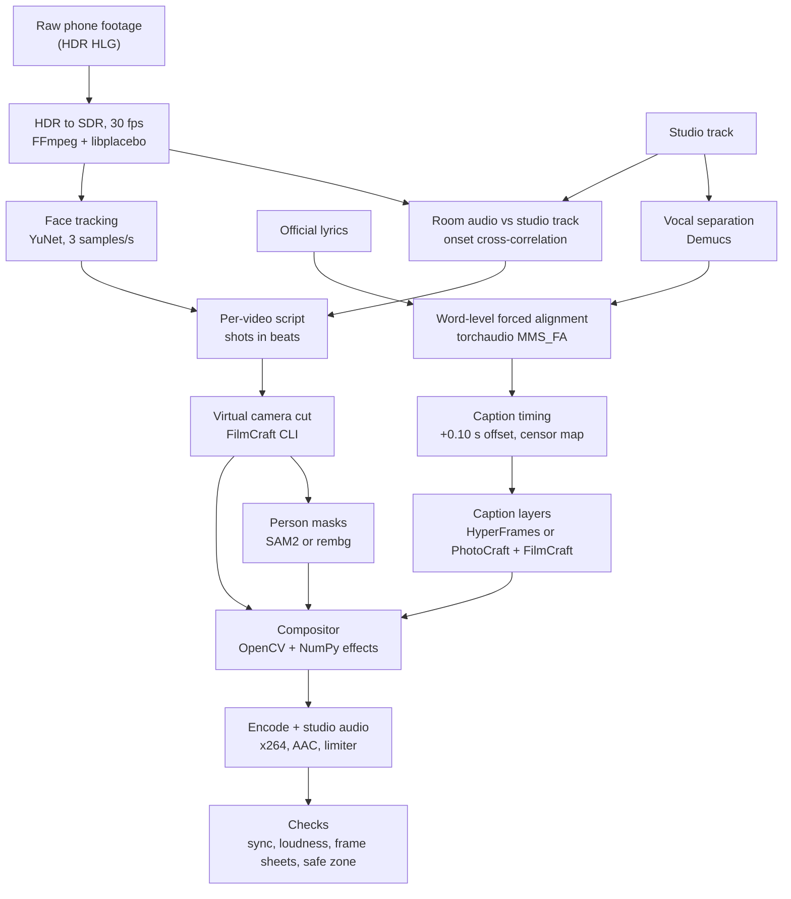

# AI Short-Video Editor

Turns raw phone footage and a studio track into short vertical videos with word-timed captions.

Case study · Python · FFmpeg · PyTorch · OpenCV · NumPy · librosa · SAM2 · Demucs

## The problem

A musician films rehearsals, studio sessions and shows on a phone. Making a 15 to 22 second vertical clip by hand means lining room audio up with the studio track, cutting on the beat, keeping lips in sync and timing captions word by word. This pipeline does it from a small script per video. I use it for one artist today, and the method fits any musician, brand or creator.

## Pipeline

Each video is a list of shot tokens: length in beats, framing on a tracked face, camera move and transition. The renderer checks that shots fill the beat range, builds the cut through an open-source editor CLI and composes frame by frame. A keyword can leave the caption line and sit large behind the person until the next phrase, hidden wherever the person mask covers it. A queue renders batches; one failure does not stop the rest.

## Engineering decisions

- **Shift the picture, keep the audio.** Captions and beat effects follow the track, so lip sync is fixed in the picture. A tool correlates mouth opening from MediaPipe face landmarks with vocal energy over a ±15 frame lag. On one clip, advancing the picture two frames (67 ms) brought all 11 measured lip anchors inside ±150 ms, using ITU-R BT.1359 tolerances.
- **Every shot reads the source frame the track is playing.** The virtual camera switches framings, and each shot starts at the source frame matching the current track time, so lips stay in sync across cuts. The room-to-track offset comes from onset correlation in 5 s windows, searched near a Whisper estimate because a repetitive beat matches at several offsets. The recorded spread across windows stayed under 7 ms.
- **libplacebo for HDR tone mapping.** The first HLG conversion used the Hable curve, which wiped out the blue in skin tones. BT.2390 tone mapping in libplacebo replaced it.
- **Proxies only where they are lossless enough.** Full-resolution sources pushed the editor past 20 GB of memory. A source gets a 1080-wide proxy only when no shot zooms past 1.02x: at 1x the proxy measured 41.6 dB PSNR, at 1.5x it lost detail. Export runs in 6 s chunks joined without re-encoding, and the frame count is asserted.
- **Forced alignment as the source of truth.** MMS_FA aligns the known lyrics to the separated vocal. Captions enter 0.10 s after each aligned onset, from a measured median of +0.11 s. Whisper only gives rough estimates, run without an initial prompt because the prompt leaked into transcripts as invented words.

## How the output is checked

- Final audio is cross-correlated with the track excerpt to catch encoder delay (±5 ms tolerance).
- FFmpeg ebur128 reports loudness and true peak, and a sample count flags anything above 0 dBFS.
- A word sheet shows one frame 0.13 s after each word, labelled with the expected word. Other sheets cover the video every 0.5 s, each shot, and the vocal gaps at 10 fps, where a moving mouth exposes miming.
- A safe-zone checker scans every caption frame against the platform UI area, with a six-case self-test.
- Caption renders must pass the HyperFrames linter, and an all-transparent render fails, since runtime script errors pass the linter.

## Known limits

- The code is per-project scripts that import each other, with hard-coded paths and a fixed tempo per song. In the video path, only the safe-zone checker has an automated test.
- Parts are Windows-specific, such as the Media Foundation AAC encoder.
- SAM2 needs hand-placed positive and negative points per shot.
- The tracker picks the main person with a clothing-colour heuristic.
- MMS_FA sometimes misplaces a repeated word; I fix it by hand from the beat grid or vocal envelope.
- Heavy per-frame effects smear faces, so some windows cap them at 45%.
- A person reviews the sheets and publishes every video.

## Stack

| Area | Tools |
|---|---|
| Language | Python 3.12 |
| Video and image | FFmpeg (libplacebo, libx264, ebur128, alimiter), OpenCV, NumPy, Pillow |
| Audio and speech | Demucs (htdemucs), torchaudio MMS_FA, faster-whisper large-v3, librosa, SciPy |
| Vision | SAM2 via Hugging Face transformers, rembg, MediaPipe Face Landmarker, OpenCV YuNet |
| Editing and captions | FilmCraft and PhotoCraft CLIs (open source), HyperFrames (HTML and GSAP to PNG) |
| Compute | PyTorch with CUDA |
| Development | Solo project, built with AI assistance (Claude Code) |

Source code is private. Happy to walk through it in a call.
